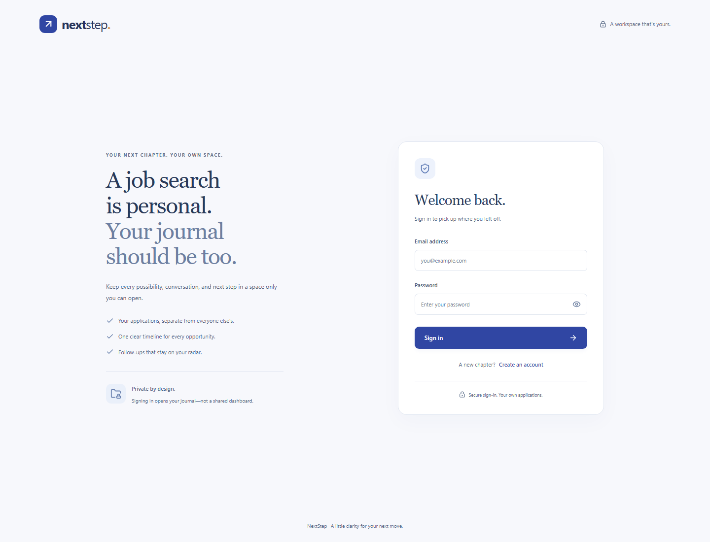
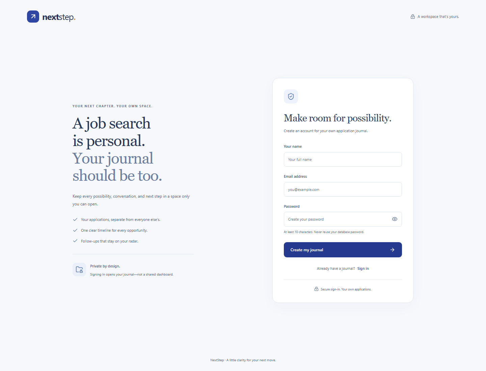

# NextStep — Hosting Repository

A dedicated deployment copy of the **NextStep Job Application Journal**. Hosting changes are made here so the final assessment repository remains frozen.

## Private-account upgrade — review branch

The `feature/private-journals` branch includes registration, login/logout, protected routes, and server-enforced user ownership. The user approved publishing this upgrade for review. It is **not merged into `main` or deployed yet**, because the hosting database configuration still needs clarification. The existing live URL continues to run the previously published version.

Each account has its own list, counts, timeline, duplicate checks, and company-number sequences. Knowing another account's application URL does not grant access. Existing shared demonstration records are not claimed by new accounts.

- **Hosting repository:** https://github.com/johanisdone/mernhost
- **Assessment repository:** https://github.com/johanisdone/mernfinal
- **Source snapshot:** `ed7e19c34e8bc3d468a3529a4a44f918aadc2593`
- **Hosted URL:** https://nextstep-journal.onrender.com

## Application

A React/Express/MongoDB tracker with private accounts, backend-generated company IDs, a strict application-status workflow, timestamped history, seven-day follow-up dates, active-duplicate protection, immutable IDs/applied dates, and status-dependent deletion. Search/filtering and counts are served by the backend and scoped to the signed-in account. Bootstrap and custom responsive CSS provide desktop/mobile views.

```text
frontend/   React + Vite client
backend/    Express API + Mongoose models
docs/       source design, verification evidence, screenshots
scripts/    isolated browser and real Atlas verification
```

## Deploy on Render

For the existing `nextstep-journal` service, update `MONGODB_URI` in **Environment** to a private database account. After the database settings are resolved and the review branch is approved for deployment, merge it into `main` and deploy that commit on the same service. No additional cluster or Render service is required.

1. In Render choose **New → Blueprint** and connect **`johanisdone/mernhost`**.
2. Render reads `render.yaml`. Choose the available service plan that fits your needs; free-tier availability/limits may change.
3. Create a **new private database user** with `readWrite` access only to a new database such as `nextstep_private`. You can reuse the same Atlas cluster. The published exam account/database must not store private accounts; startup rejects that configuration.
4. Set **`MONGODB_URI`** privately in Render to that new user's connection string, including `/nextstep_private`. Preserve query parameters and encode password characters correctly. Never commit this private credential or post it in chat.
5. Deploy after the review branch is merged. In the service dashboard open **Connect → Outbound** and allow every listed Render CIDR range in Atlas **Network Access**.
6. If the first startup failed before those ranges became active, use **Manual Deploy → Deploy latest commit** after allowing them.
7. Open the assigned Render URL and `/api/health`, then register a new application account.

Expected health response:

```json
{ "success": true, "message": "Database connected.", "data": { "ready": true } }
```

Both frontend and API are served by the same Node service. The client calls `/api`; it contains no localhost API address in its production build. The Render origin is detected from `RENDER_EXTERNAL_URL`, so there is no need to guess a hostname or manually enter `CLIENT_ORIGIN`. `FRONTEND_ORIGIN` is an optional explicit override for other hosting setups.

### Manual Web Service settings

| Setting | Value |
| --- | --- |
| Repository | `johanisdone/mernhost` |
| Branch | `main` |
| Runtime | Node |
| Root directory | Leave empty |
| Build command | `npm ci --include=dev && npm run build` |
| Start command | `npm start` |
| Health check | `/api/health` |

### Host environment variables

| Key | Value |
| --- | --- |
| `MONGODB_URI` | Private Atlas URI including database name |
| `NODE_ENV` | `production` |
| `NODE_VERSION` | `22` |
| `APP_TIMEZONE` | `Asia/Kolkata` |
| `MONGOMS_DISABLE_POSTINSTALL` | `1` |
| `TRUST_PROXY` | `1` on Render |

Render sets `PORT` and `RENDER_EXTERNAL_URL`. No JWT/session-signing secret is needed: secure random session tokens are stored as SHA-256 digests in MongoDB. Cookies are HttpOnly, SameSite=Lax, and Secure in production, with an eight-hour expiry. Logout deletes the server-side session. Passwords are bcrypt-hashed. Public registration cannot choose an owner/role.

This repository does not include real `.env` files. They are required in the original **assessment** repository, which is a separate submission with its own intentionally shared exam settings. For hosting, store configuration in the provider's dashboard.

## Local development

```sh
npm install
```

Copy `backend/.env.example` to `backend/.env` and fill in the **private** Atlas URI. Then:

```sh
npm run dev
```

Frontend: http://localhost:5174. API: http://localhost:5001. For the built application: `npm run build`, then `npm start` and open http://localhost:5001. Real `.env` files remain ignored here.

## APIs

All responses follow `{ success, message, data }`.

| Method | Route | Purpose |
| --- | --- | --- |
| GET | `/api/health` | Database readiness |
| POST | `/api/auth/register` | Create account using name, email, password; starts a session |
| POST | `/api/auth/login` | Authenticate email/password; rotate browser session |
| POST | `/api/auth/logout` | Revoke current session and clear cookie |
| GET | `/api/auth/me` | Read the signed-in account; 401 without a valid session |
| GET | `/api/applications/options` | Form options and current calendar date |
| GET | `/api/applications/stats` | Counts per status and overdue count |
| GET | `/api/applications?company=infosys&status=Applied` | Search/filter list; optional page and limit |
| POST | `/api/applications` | Create application |
| GET | `/api/applications/:id` | Details and status history |
| PATCH | `/api/applications/:id` | Edit permitted fields |
| PATCH | `/api/applications/:id/status` | Valid next-stage transition |
| DELETE | `/api/applications/:id` | Delete only in permitted stages |

Except for health and form options, application data requires a valid session. Requests are scoped by the account loaded from that session. Cross-user IDs return 404, even for edits, deletion, and status changes; missing/expired sessions return 401. Browser-origin mismatches return 403. Authentication endpoints are rate limited. Lists and statistics cannot be redirected to another owner through query parameters or body fields.

Private storage uses `private_accounts`, `private_sessions`, `private_applications`, and `private_company_counters`. The original shared application collections are not migrated, deleted, or assigned to the first registrant. A compound owner+applicationId index allows different users to have their own `JA-INF-001`; active company/role uniqueness is per owner as well.

## Verify

```sh
npm test
npm run build
npx playwright install chromium
npm run test:ui
```

Isolated tests do not access Atlas. To verify the new account flow against a private hosting database, configure a private local environment file and run `npm run verify:atlas`. It creates a uniquely named temporary account and removes only that account's sessions, applications, and counters. This new private-Atlas verification is pending private database setup; the original exam account cannot be used for it.

The local account upgrade passed **27 API/hosting/session/ownership scenarios and 15 browser scenarios**. The browser journey signs in as two users, checks that neither sees the other's applications, and verifies registration, logout, refresh, all original workflows, and mobile authentication pages. Evidence: [account API tests](docs/evidence/accounts.json), [core API tests](docs/evidence/api.json), [browser checks](docs/evidence/browser.json).

The [previous live smoke check](docs/evidence/hosted.json) and [source Atlas check](docs/evidence/atlas.json) are historical evidence for the pre-login version. They do not establish that the private-account upgrade is deployed. After approval and deployment, verify register/login/logout, two-user isolation, and private Atlas persistence on the live URL.

## Views






## Deployment acceptance

- [x] Private-account upgrade approved for GitHub push to the review branch.
- [ ] New private Atlas user/database configured in Render.
- [ ] Assigned HTTPS URL loads the new sign-in page.
- [ ] `/api/health` reports `ready: true` after the private database change.
- [ ] Register/login/logout and two-account isolation work on the live URL.
- [ ] Add, search, filter, view, edit, status change, and allowed deletion work.
- [ ] Duplicate, future-date, final-status, and forbidden-deletion rules hold.
- [ ] Refreshing `/applications/:id` serves the SPA correctly with session protection.
- [ ] Mobile layout works and requests target the same origin.

Email verification, password reset, multi-factor authentication, and logout-all-devices are not implemented. The current session can be revoked by signing out; other device sessions expire independently. Rate limiting is in-process, so a shared rate-limit store would be needed before scaling to multiple instances. The assessment repository is not modified as part of this hosting upgrade.
