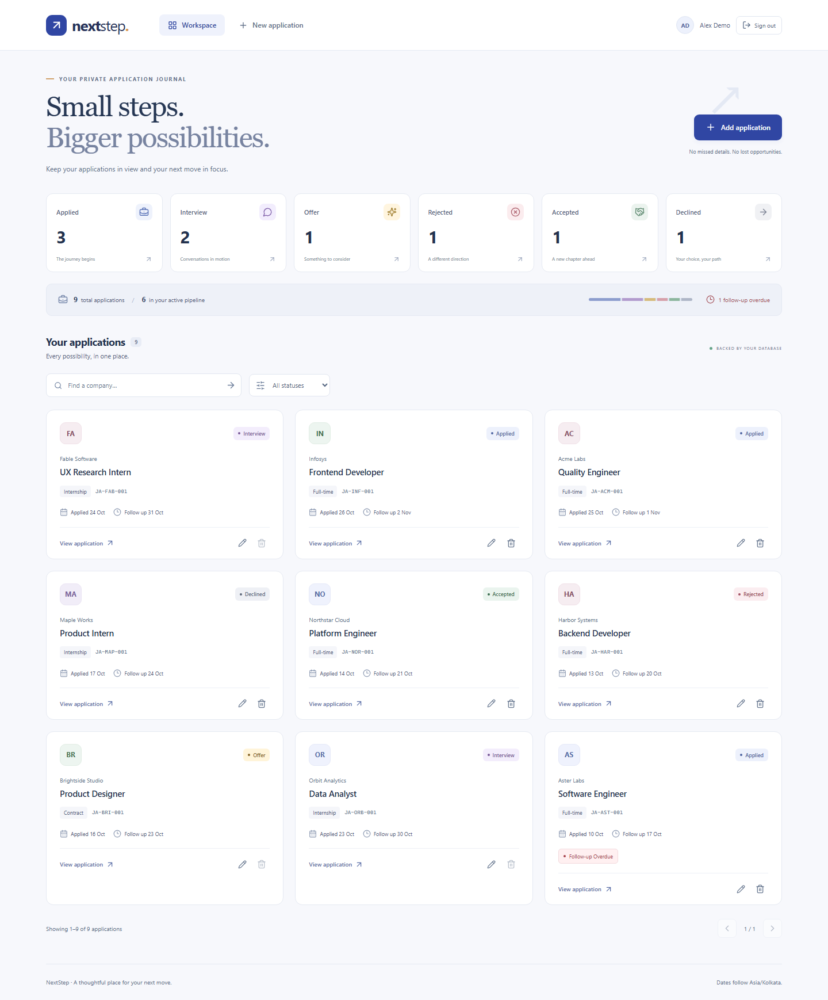
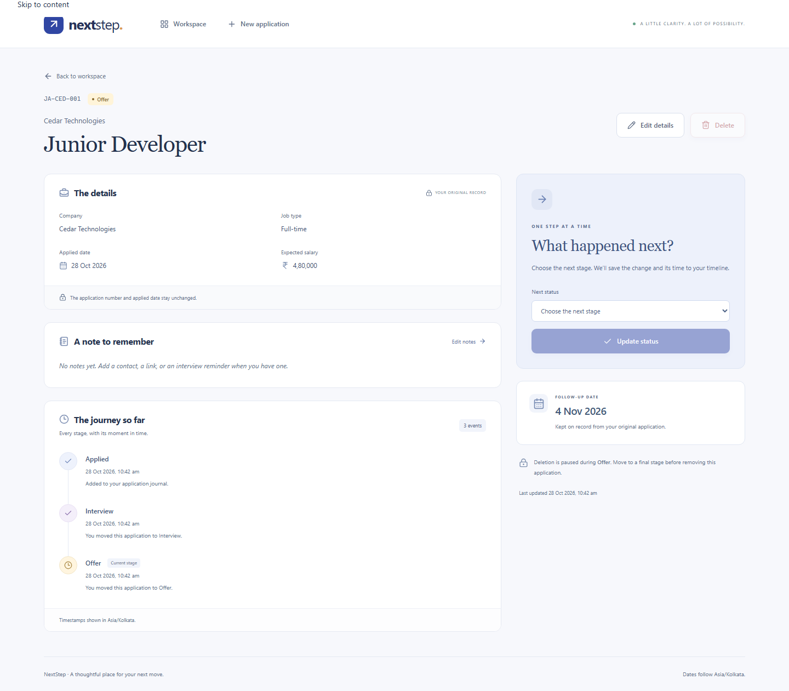

# NextStep — Hosting Repository

A dedicated deployment copy of the **NextStep Job Application Journal**. Hosting changes are made here so the final assessment repository remains frozen.

- **Hosting repository:** https://github.com/johanisdone/mernhost
- **Assessment repository:** https://github.com/johanisdone/mernfinal
- **Source snapshot:** `ed7e19c34e8bc3d468a3529a4a44f918aadc2593`
- **Hosted URL:** https://nextstep-journal.onrender.com

## Application

A React/Express/MongoDB tracker with backend-generated company IDs, a strict application-status workflow, timestamped history, seven-day follow-up dates, active-duplicate protection, immutable IDs/applied dates, and status-dependent deletion. Search/filtering and counts are served by the backend. Bootstrap and custom responsive CSS provide desktop/mobile views.

```text
frontend/   React + Vite client
backend/    Express API + Mongoose models
docs/       source design, verification evidence, screenshots
scripts/    isolated browser and real Atlas verification
```

## Deploy on Render

1. In Render choose **New → Blueprint** and connect **`johanisdone/mernhost`**.
2. Render reads `render.yaml`. Choose the available service plan that fits your needs; free-tier availability/limits may change.
3. Set **`MONGODB_URI`** privately to the Atlas connection string, including `/mernfinal_exam` or the database you intend this hosted copy to use. Preserve query parameters and encode password characters correctly.
4. Deploy. In the service dashboard open **Connect → Outbound** and allow every listed Render CIDR range in Atlas **Network Access**.
5. If the first startup failed before those ranges became active, use **Manual Deploy → Deploy latest commit** after allowing them.
6. Open the assigned Render URL and `/api/health`.

Expected health response:

```json
{ "success": true, "message": "Database connected.", "data": { "ready": true } }
```

Both frontend and API are served by the same Node service. The client calls `/api`; it contains no localhost API address in its production build. The Render origin is detected from `RENDER_EXTERNAL_URL`, so there is no need to guess a hostname or manually enter `CLIENT_ORIGIN`. `FRONTEND_ORIGIN` is an optional explicit override for other hosting setups.

### Manual Web Service settings

| Setting | Value |
| --- | --- |
| Repository | `johanisdone/mernhost` |
| Branch | `main` |
| Runtime | Node |
| Root directory | Leave empty |
| Build command | `npm ci --include=dev && npm run build` |
| Start command | `npm start` |
| Health check | `/api/health` |

### Host environment variables

| Key | Value |
| --- | --- |
| `MONGODB_URI` | Private Atlas URI including database name |
| `NODE_ENV` | `production` |
| `NODE_VERSION` | `22` |
| `APP_TIMEZONE` | `Asia/Kolkata` |
| `MONGOMS_DISABLE_POSTINSTALL` | `1` |

Render sets `PORT` and `RENDER_EXTERNAL_URL`. No administrator, login, or JWT configuration is required; this is the single-seeker tracker specified in the assessment.

This repository does not include real `.env` files. They are required in the original **assessment** repository, which is a separate submission with its own intentionally shared exam settings. For hosting, store configuration in the provider's dashboard.

## Local development

```sh
npm install
```

Copy `backend/.env.example` to `backend/.env` and fill in the Atlas URI. Then:

```sh
npm run dev
```

Frontend: http://localhost:5174. API: http://localhost:5001. For the built application: `npm run build`, then `npm start` and open http://localhost:5001. Real `.env` files remain ignored here.

## APIs

All responses follow `{ success, message, data }`.

| Method | Route | Purpose |
| --- | --- | --- |
| GET | `/api/health` | Database readiness |
| GET | `/api/applications/options` | Form options and current calendar date |
| GET | `/api/applications/stats` | Counts per status and overdue count |
| GET | `/api/applications?company=infosys&status=Applied` | Search/filter list; optional page and limit |
| POST | `/api/applications` | Create application |
| GET | `/api/applications/:id` | Details and status history |
| PATCH | `/api/applications/:id` | Edit permitted fields |
| PATCH | `/api/applications/:id/status` | Valid next-stage transition |
| DELETE | `/api/applications/:id` | Delete only in permitted stages |

## Verify

```sh
npm test
npm run build
npx playwright install chromium
npm run test:ui
```

Isolated tests do not access Atlas. To repeat the real Atlas browser check against a dedicated `mernfinal_exam` database, configure a private local environment file and run `npm run verify:atlas`. It creates and removes only its own uniquely named verification fixture.

The hosting copy passed **17 API/hosting scenarios and 10 browser scenarios** after a clean dependency install and production build. The Atlas evidence copied from the source snapshot refers to the previously verified exam database journey.

The [live smoke check](docs/evidence/hosted.json) passed eight checks against https://nextstep-journal.onrender.com: frontend rendering, database health, API counts/list/search/options, form and detail deep links, empty-form feedback, mobile layout, and no uncaught JavaScript errors. This check did not create or modify application records; full hosted CRUD was not rerun.

## Views





## Deployment acceptance

- [x] Assigned HTTPS URL loads the application.
- [x] `/api/health` reports `ready: true`.
- [ ] Add, search, filter, view, edit, status change, and allowed deletion work.
- [ ] Duplicate, future-date, final-status, and forbidden-deletion rules hold.
- [x] Refreshing `/applications/:id` serves the SPA correctly.
- [x] Mobile layout works and requests target the same origin.

The public tracker is a single shared journal. Use fictional data for the demonstration. The assessment repository is not modified as part of hosting setup.
